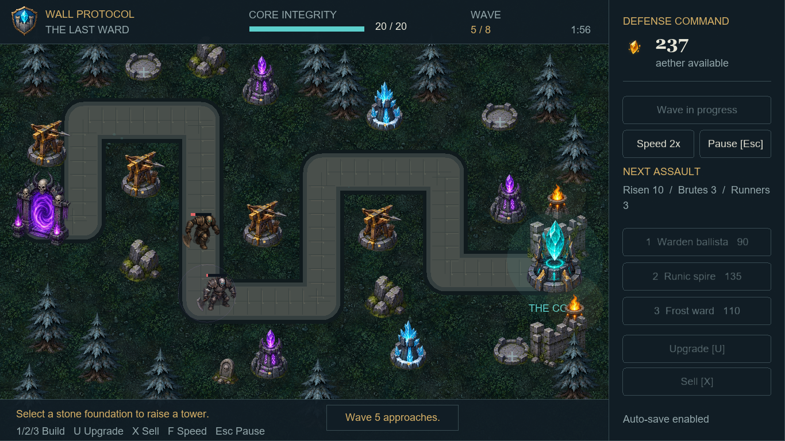

# Wall Protocol — The Last Ward

Темне фентезі / tower defense від **Eclipse Wire**. Захистіть кристалічне ядро, поєднуючи балісти, рунні шпилі та крижані обереги. Вісім хвиль завершуються боєм із Кістяним колосом.

## Запуск

- Готова Windows-гра: розпакуйте `build/WallProtocol.zip` і запустіть `Wall Protocol.exe`. Файли `data.win` та `options.ini` мають залишатися поруч.
- Редагування: відкрийте `Wall Protocol.yyp` у GameMaker LTS 2026 і натисніть Run.
- Якщо проєкт уже відкритий у редакторі, перезавантажте зміни з диска або перевідкрийте проєкт.
- Для гри не потрібні Python, мережа, зовнішні SDK або API-ключі.

Початкова версія перед перебудовою: `build/before-rework.zip`.

## Що реалізовано

- 33 об'єкти з окремими Create/Step/Draw та 6 кімнат.
- Стартова заставка з вашим `Eclipse_Wire_logo.png`, вибір англійської/української при першому запуску.
- Головне меню, пауза, налаштування, окрема кімната історії/довідника/авторів, перемога й поразка.
- 3 типи веж, 3 рівні покращення, продаж із поверненням 70% вкладень; 4 типи ворогів.
- Снаряди, шкода по площі, сповільнення, коректний вибір першого ворога за пройденою відстанню.
- Згенерована ілюстрація меню, текстура землі, окремі спрайти та двокадрові анімації ворогів.
- 9 звукових ефектів, атмосферна музична петля, незалежна гучність музики/ефектів.
- Власна багаторозмірна Windows-іконка, повний екран і масштабування вікна зі збереженням пропорцій.
- Збереження активної хвилі: здоров'я, ефір, вороги, їх сповільнення, вежі, таймери та снаряди. Після завантаження — пауза.
- Автозбереження кожні 30 секунд, між хвилями, перед довідником та поверненням до меню. Перевірка JSON і резервна копія.
- Кнопки, майданчики, маршрут, портал, ядро й декорації вже розставлені в кімнатах. Fallback відновлює відсутні необхідні елементи.
- Окремий тестовий полігон: вежі й вороги, ручний виклик хвиль, ефір, безсмертя, ремонт ядра, екрани результатів і скидання. Збереження походу захищені.

## Нове у версії 1.4

Сюжетний режим, п'ять карт, слоти збереження. Деталі — у [CHANGELOG.md](CHANGELOG.md).

- **Сюжет «Остання варта»:** п'ять розділів на п'яти картах (ліс, болото, крига, попелища, тронна зала) з розмовами героїв, босами й вибором однієї з двох кінцівок. До 3 зірок на розділ.
- **Карти:** нові маршрути, майданчики й декор створює `tools/story_maps.py`; кожна карта має власну погоду, колір землі та туман.
- **Збереження:** автозбереження + три ручні слоти з картками (режим, розділ, хвиля, ядро, ефір, час, дата), підтвердження перезапису й видалення, відновлення з резервної копії, «Продовжити» бере найновіше. Старі збереження 1.1–1.3 працюють.
- **Режим «Виживання»** лишився як у 1.3.

> Версія 1.4 **не компілювалась і не запускалась** у GameMaker; сюжетний текст, розкладка сторінок і баланс розділів ніким не перевірені в грі (баланс лише оцінено симуляцією `tools/balance_sim.py`). Див. [Що треба зробити.md](Що%20треба%20зробити.md).

## Нове у версії 1.3

Графіка, анімація, звук і інтерфейс. Деталі — у [CHANGELOG.md](CHANGELOG.md).

- **Графіка:** світні кристали, ядро й портал, жаровні; рунні кола під вежами й радіус дії основи при наведенні на кнопку будівництва; туман, світляки й віньєтка на полі бою; шлейфи снарядів; анімоване меню.
- **Анімація:** поява й стискання ворогів, тіні, привиди на місці загибелі, тремтіння екрана при проривах і боса, плавні переходи між кімнатами, лічильник ефіру, що «біжить».
- **Звук:** 20 оригінальних синтезованих звуків (18 ефектів + 2 стереопетлі) і **адаптивна музика** — бойовий шар підіймається під час хвилі.
- **Інтерфейс:** градієнтні панелі, кнопки з плавним наведенням і іконками веж, плавні оверлеї, зірки результату з'являються по черзі.
- **Інструменти:** `tools/build_audio.py`, `tools/build_fx_art.py` (повністю відтворюють аудіо й спрайти ефектів).

> Версія 1.3 теж **не компілювалась і не запускалась** у GameMaker, а музику й ефекти ніхто не прослуховував — лише числовий аналіз. Див. [Що треба зробити.md](Що%20треба%20зробити.md).

## Нове у версії 1.2

Усі зміни — точкові правки GML у наявних подіях; нових ресурсів, подій чи кімнат немає. Деталі — у [CHANGELOG.md](CHANGELOG.md).

- **Пріоритет цілі веж** (T або кнопка в нижній панелі): перший на дорозі / останній / найсильніший / найближчий. Режим зберігається в збереженні; старі збереження сумісні.
- **Відгук бою:** спливаючі `+ефір` при вбивстві, `-N` при прориві, червона рамка при ударі по ядру, пульсація смуги ядра при ≤ 6 HP, вибухи при загибелі Колоса, ритм кроку ворогів, аура боса.
- **Інформація:** банер початку хвилі (окремий для фінальної), смуга прогресу хвилі, склад хвилі іконками ворогів із лічильниками, підказка «що дасть покращення» при наведенні на кнопку Upgrade.
- **Результат:** 1–3 зірки за міцністю ядра, час проходження, рекорд (зберігається в налаштуваннях і показується в головному меню).
- **Зручність:** автопауза при втраті фокусу вікна, Numpad 1–3 для будівництва, ПКМ знімає вибір, підпис «THE CORE» більше не перекривається декораціями.
- **Інструмент:** `tools/check_gml.py` — статична перевірка GML без GameMaker (дужки, лапки, виклики `wp_*`, кількість аргументів, змінні, ресурси).

> **Важливо:** версія 1.2 написана без доступу до GameMaker і **не компілювалась та не запускалась**. Статична перевірка (`check_gml.py`, `validate_project.py`) пройдена, але Project Health і Run в IDE ще треба виконати — див. [Що треба зробити.md](Що%20треба%20зробити.md).

## Керування

| Дія | Клавіші |
| --- | --- |
| Вибрати основу / вежу / кнопку | ЛКМ |
| Побудувати балісту / рунний шпиль / оберіг | 1 / 2 / 3 (або Numpad 1 / 2 / 3) після вибору основи |
| Покращити / продати | U / X |
| Змінити пріоритет цілі вибраної вежі | T або кнопка «Ціль» у нижній панелі |
| Зняти вибір основи | ПКМ |
| Почати наступну хвилю | Пробіл |
| Змінити швидкість 1x / 2x | F |
| Пауза / повернення | Esc або P для відкриття паузи |
| Повний екран | F11 |
| Тестова кімната з головного меню | F2 або кнопка «Тестова кімната» |
| Навігація меню | Tab, ↑, ↓, Enter |
| Точна зміна гучності | ЛКМ по шкалі або ← / → на вибраній кнопці |

## Кімнати й редагування

| Кімната | Призначення |
| --- | --- |
| `rm_boot` | Заставка студії та початковий вибір мови |
| `rm_menu` | Головне меню й опції |
| `rm_text` | Історія, керування, автори |
| `rm_game` | Основний ігровий рівень |
| `rm_test` | Ручний тестовий полігон із готовою розстановкою та панеллю керування |
| `Room1` | Збережений старий ресурс, переобладнаний у додаткову кімнату для експериментів |

Почніть із `rm_game`: переміщуйте `obj_build_pad`, `obj_path_node`, `obj_core`, `obj_portal` та декорації. У вузлів маршруту задається `node_order`, у майданчиків — стабільний `pad_key`. Кнопки можна переміщувати, змінювати `action`, `page`, `button_w` і `nav_order` в інспекторі. Деталі: [Довідка програміста](Довідка%20програміста.md).

`rm_test` відкривається на паузі. Натисніть «Продовжити» або Esc, щоб увімкнути тестові кнопки. Стартові ефір, хвиля й безсмертя задаються у властивостях `obj_sandbox`; вежі, вороги, маршрут і кнопки редагуються безпосередньо в Room Editor. Попередня версія перед додаванням полігона: `build/before-sandbox.zip` (код і метадані).

## Перевірка збірки 26.09.2026 (версія 1.1)

Нижче — результати для версії 1.1. Зміни 1.2 цією перевіркою **не охоплені**.

- GameMaker runtime **2026.0.0.23**: ресурси завантажені й зв'язані, GML скомпільований, Windows-пакет створений.
- **64 runtime-перевірки пройдено**, включно з повними 8 хвилями на 1x та 2x без додаткового ефіру.
- Перевірено відновлення бою зі снарядами, резервне збереження, неправильну версію JSON, змінену мапу, паузу, переходи між кімнатами, перемогу та поразку.
- Перевірено стартову розстановку полігона, появу всіх ворогів, очищення, ефір, ремонт, безсмертя, фінальну хвилю, результати, скидання, fallback кнопок і повернення до незміненого походу.
- Знімки справжнього runtime перевірені для меню, поля, паузи, опцій, українського довідника, заставки та вибору мови.
- Звіти й знімки: `build/verification/`. Перевірка JSON5/посилань: `build/metadata-check.json`.

**Окремий ручний пункт:** Project Health і Run саме з відкритої IDE ще потрібно підтвердити. Захоплення IDE повертало `SetIsBorderRequired`, а керування вікнами було зупинене Escape. Компіляція та перевірки вище виконані справжнім GameMaker compiler/Windows Runner, а не імітацією GML.

Походження графіки, звуків і запити генерації: [docs/ART.md](docs/ART.md).
